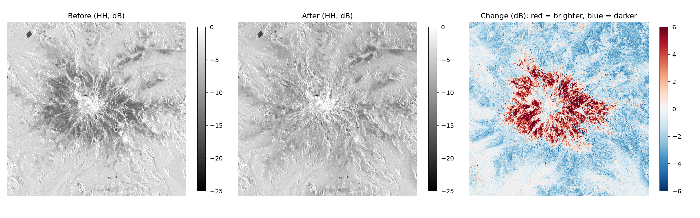

# SAR-Watch: Mount Rainier through the clouds

**NASA Space Apps Challenge 2026 · Challenge: Dancing with the SARs · Boston, MA**

SAR-Watch uses L-band radar data from the NASA-ISRO **NISAR** mission to detect and map
surface change on Mount Rainier, Washington, between summer and late autumn 2026.
Radar sees through clouds and works at night, so it can watch mountains that optical
satellites often miss.



## Key result

Between **July 3** and **October 31, 2026**, a ring of strong brightening (**+4 to +6 dB**)
appears over Rainier's glacier zone. At a 3 dB threshold:

- **7.4%** of the study area became brighter (about 39 km², concentrated on the glaciers)
- **6.8%** became darker (mostly lower slopes and forests)

**Interpretation:** in July, wet melting snow on the glaciers absorbs L-band microwaves and
appears dark. By late October, surfaces have refrozen and new snow is dry. Dry snow is nearly
transparent at L-band, so the signal reaches rough ice and firn beneath and returns strongly.
The radar is watching the mountain switch from summer melt to winter freeze.

Stable features, such as a lake northwest of the summit, look the same on both dates,
which supports the processing.

## Data

| Role | Date | NISAR L2 GCOV product |
|------|------|-----------------------|
| Before | 2026-07-03 | `NISAR_L2_PR_GCOV_024_106_A_025_4005_DHDH_A_20260703T130329_...` (provisional) |
| After | 2026-10-31 | `NISAR_L2_PR_GCOV_034_106_A_025_4005_DHDH_A_20261031T130327_...` (validated) |

Both: Track 106, Frame 25, ascending, HH/HV polarizations, from the
[Alaska Satellite Facility](https://search.asf.alaska.edu/). Data courtesy of NASA/JPL and ISRO.

## Method

1. Stream only the Mount Rainier subset of each HDF5 file from ASF (no 7 GB download), using `earthaccess` + `h5py`.
2. Crop to a 0.3° × 0.2° box using the product's UTM 10N grid (10 m pixels, 2259 × 2322).
3. Apply a 7 × 7 boxcar filter to reduce speckle, then convert power to decibels.
4. Change = After (dB) − Before (dB), for HH and HV.
5. Threshold the change map and report the fraction of area brighter or darker.

## Limitations

- The July product is provisional and October is validated, so part of the small uniform
  darkening at low elevations may be a calibration offset between product versions.
- Backscatter change has several possible causes (moisture, freezing, snow, vegetation).
  Interpretations should be confirmed with optical imagery, weather records, or field data.
- Only two dates are compared. A full 12-day time series would separate seasonal cycles from trends.

## Run it

```
pip install -r requirements.txt
python sar_process.py BEFORE.h5_or_URL AFTER.h5_or_URL
streamlit run app.py
```

The app has a July-to-October blend slider, a thresholded change map with area statistics,
and a "Radar 101" page explaining how L-band radar sees ice, snow, soil, and forests.

## Team

Utkarsh Kumar, PhD candidate in Electrical and Computer Engineering (RF/analog IC design), Northeastern University.
## Use of AI
Code (sar_process.py, app.py), README text, and demo video editing were developed with assistance from Claude (Anthropic), an AI assistant. All results come from real NISAR data processed by this code; no images are AI-generated.
